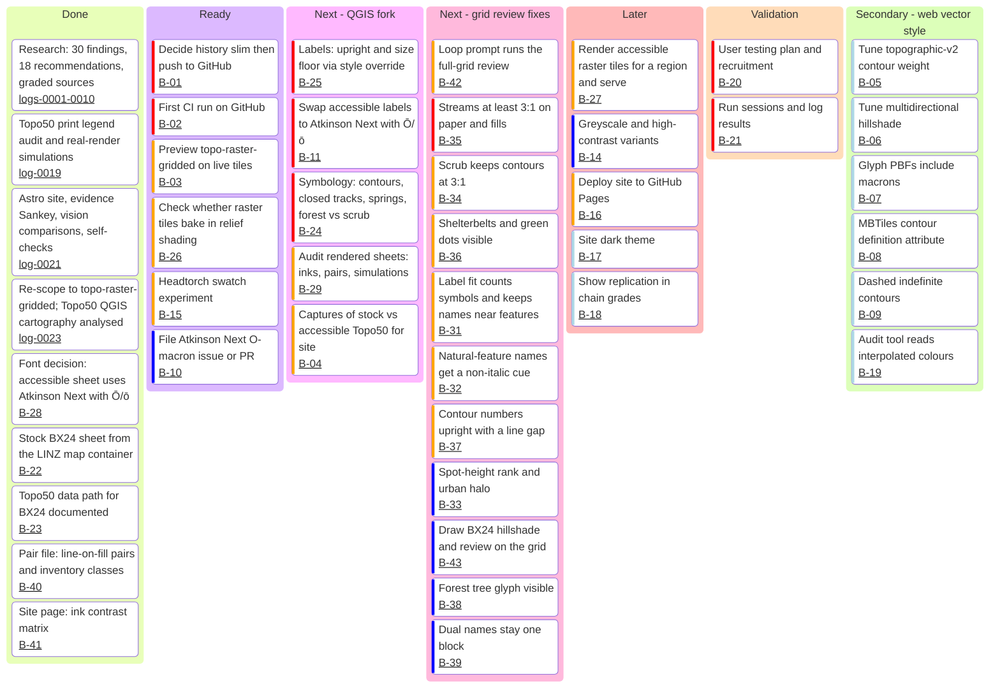

# Backlog

Status as of 2026-11-06, after log 0099. Start with "Next work" below.
Label placement (G2, B-31) is parked. The order now is: style and symbology, full LINZ sheets, a legend of our styles, then vector parity. Log 0090 lists the remaining raster style items.
`tools/render_sheets.py` draws all 445 sheet faces as 150 dpi GeoTIFFs, outside the repo. Flat names are not pinned off BX24. The sheets are a source for B-27 (log 0091). Those rasters predate the open foot-track fix, so open foot tracks show the closed cross (log 0092).
`tools/render_legend.py` draws the accessible swatches into the sheet legend (B-46, log 0092).
Black names on the urban fill take an urban-fill halo from a precomputed `urban_text.json` (B-45, log 0093). The sheet project has no `urban_text.json` yet, so sheet halos stay paper.
Josh accepts the 17% spot-height rank step as an R-09 exception, and counts the stream vs index width step as the R-01 shape cue (log 0093).
Stream is `#004C99` (log 0083). Rivers and canals are 0.25 mm. Drains are 0.15 mm (log 0071). Scrub is alpha 26 plus `#6A9A50` `third_arc` plant marks at 0.18 mm (logs 0068, 0071). A greener scrub fill waits for vector alpha (log 0076). Shelterbelt is `#008A00` (log 0099). Grid is `#269FD2`.
Natural names are Regular in index brown `#7A5542` (logs 0072, 0080). Stock Bold town names draw in patched Atkinson Bold (log 0080). Spot heights are black, 6 pt, and pinned (logs 0077, 0081, 0084). Contour-number FontMarkers are Regular with a 0.3 mm white halo (log 0082). State highway numbers draw in a white shield above the road (log 0090).
Closed tracks use `cross2` 0.7 mm every 3 mm. Foot tracks are 0.2 mm. Poled routes and connectors draw as dots (log 0094). G1 passed. R-11 is met (log 0066). R-01 stays open.
A recommendation is met only after the full-grid stock review in `docs/method.md` (log 0057).
Log 0025 is the stock sheet. Log 0024 records the font decision: the
accessible sheet uses Atkinson Hyperlegible Next with Ō/ō; the stock sheet
keeps Nimbus. The estuary name draws upright (log 0029).
The square uses the sheet map layers. The pink lines were a hidden layer (log 0029).
Square draws use QGIS 4.2.3 at `/Applications/QGIS-final-4_2_3.app` (log 0031). The sheet export stays on the map image. QGIS 3.36.3 cannot open the project (log 0030).
R-09 is open again (log 0058). Floors hold. Spot heights need their own rank. Names collide or sit away from their feature on the grid. Suburb and Locality are 11 px. Town is 14 px. City is 17 px (log 0032).
R-07 is met. Label ink is at least 4.8:1 against the drawn buffer. The text-contrast table has no fail rows except the two highway shields (log 0033).
R-10 is met. Scrub is `#A3CC90` at alpha 26 plus `third_arc` plant marks (log 0068). Scattered is `#E0EDD8` plus a pattern (log 0034).
R-11 is met (log 0066). Closed tracks use `cross2` 0.7 mm every 3 mm (log 0094). That mark does not read as a railway, an embankment or a cliff on the G1 cells. Historic labels keep hue and meet 3:1 under red light (log 0035).
R-17 is met. Hot is a black ×. Cold is a `#005C8F` circle. Native is `#E1EAC3`. Scrub keeps its plant marks. Contour-number FontMarkers use the index ink (logs 0036, 0051).
R-01 is open again (log 0058). Index contour on scrub is 4.35:1 grey and 3.02:1 red after scrub alpha 26 (log 0063). Streams `#004C99` are 8.42:1 grey (log 0083) and shelterbelts `#008A00` are ~4.5:1 on paper (log 0099). Grid `#269FD2` is 3.01:1. Intermediate contours have a 0.2 mm `#7A5542` casing at alpha 0.5. Index is 0.35 mm at alpha 0.85. Index versus paper is 4.60:1 grey and 3.28:1 red. Intermediate casing versus paper is 2.23:1 grey and 1.89:1 red. Index versus urban still fails. Road fill `#EC7000` is 3.06:1 grey. The dark road casing still carries the road under red light (logs 0037, 0038, 0050, 0051, 0053, 0054).
R-05 is open again (log 0059). Contour-number FontMarkers are Regular in the apply step. Natural-feature names use index brown, Regular (logs 0072, 0080). Both still need the grid review.
R-08 stays provisional. Vector labels use 0.05 em from the style file. Raster along-line labels keep normal spacing. No A/B test (log 0039).
R-12 is met. `tracks.access.reserved_channel` is `casing_colour`. `tracks.access.painted` is false. Access is not drawn (log 0042).
R-03 stays open. Hillshade is an overlay at 337.5°. Raster shade waits for `dem.tif` beside the project. Vector reads the same numbers (log 0044).
R-14 is met. Pair colours that live in `tools/style-topo50.json` are dotted paths. C6 resolves them before it measures (log 0045).
R-13 stays open. Greyscale-safe print and high-contrast web inks are not named. Do not invent palettes (log 0046).
R-15 is met. The vector style is the raster style on Shortbread tiles. `P` holds no colour hex (log 0047).
R-04 is met on the painted Map5View inks. Index is `#7A5542` at 0.85. Intermediate is `#B08872` at 0.5. Road fill is `#EC7000`. Highways stay `#E31A1C`. Contour numbers stay opaque in the index ink. Pipeline is not on Map5View (logs 0050, 0051, 0053, 0054).
The starting point remains LINZ's `topo-raster-gridded`, i.e.
Topo50 itself (log 0023, R-18). IDs are stable;
reference them from commits and research-log entries. The board needs mermaid
with `kanban` support (11.4+); validated with mermaid 12.2.0.

## Next work (from 2026-11-06)

Research stopped at log 0095. Work these items in order. Each item says what to change, where, how to check it, and when it is done. Josh's decisions are quoted. Do not reopen them.

### How to run a pass (local Mac)

The 2026-11-05 session ran these steps from temporary scratchpad scripts. These are the commands, so they do not depend on those scripts.

- **QGIS env** (needed by every `render_*`, `fit_*`, `tag_*` tool):
  ```sh
  APP=/Applications/QGIS-final-4_2_3.app/Contents
  export PYTHONHOME=$APP/Frameworks PYTHONPATH=$APP/Resources/python3.12/site-packages \
    DYLD_LIBRARY_PATH=$APP/MacOS:$APP/Frameworks PROJ_DATA=$APP/Resources/qgis/proj \
    PROJ_LIB=$APP/Resources/qgis/proj GDAL_DATA=$APP/Resources/qgis/gdal \
    QT_QPA_PLATFORM=offscreen QGIS_PREFIX_PATH=$APP/MacOS
  QPY=$APP/MacOS/python3.12
  ```
  Unset `PYTHONHOME PYTHONPATH DYLD_LIBRARY_PATH` before running host `python3` or `uv`.
- **Paths:** `W=~/Projects/github.com/linz/topo50-bx24/squares`. Stock project `$W/stock/nztopo50.qgs`. Accessible project `$W/accessible/nztopo50.qgs`. Fonts `~/Projects/github.com/linz/topo50-bx24/accessible/fonts` (Atkinson Hyperlegible Next Macron Regular + Bold). Stock fonts `$W/fonts-stock`.
- **Apply:** `python3 tools/override_topo50_project.py $W/stock/nztopo50.qgs $W/accessible/nztopo50.qgs`. Before apply, `urban_text.json` and `carto_fit.json` must sit beside the target `.qgs` (see `tools/README.md`).
- **BX24 4 km review grid** (27 cells, 945 px = 4 km): `$QPY tools/render_square.py --project $W/accessible/nztopo50.qgs --font <fonts> --extent 1564000,5154000,1588000,5190000 --width 5670 --height 8505 --dpi 300 --output render/bx24-4km/face-accessible.png`, then `python3 tools/crop_grid.py --stock render/bx24-4km/face-stock.png --accessible render/bx24-4km/face-accessible.png --out render/bx24-4km`. The stock face does not change; reuse it. Review stock and accessible cells side by side (`docs/method.md`).
- **Legend:** after apply, `$QPY tools/render_legend.py --project $W/accessible/nztopo50.qgs --stock-legend topo-legend-1.tif --font <fonts>` (stock image: `~/Projects/github.com/linz/topographic-system/e2e/assets/topo-legend-1.tif`). Swatches stay at true sheet size (Josh, B-46).
- **Symbol table page:** `uv run python tools/export_symbol_table.py`. Commit `site/src/data/symbols.json` and `site/public/symbols/*.png`. CI does not run it (inputs are outside the repo).
- **Label fit and collision count** (only for label changes): `$QPY tools/fit_carto_labels.py --project … --font … --extent …`, re-apply, then `$QPY tools/count_label_collisions.py --project … --font … --extent … --output acc.json --compare stock.json`.
- **Never** use `overlay_intersects()` or other layer lookups in label or symbol expressions. They deadlock `render_square.py` and `render_sheets.py` (logs 0090, 0091). Precompute instead (pattern: `tools/tag_urban_text.py`).
- QGIS 4.2.3 treats a NULL `enabled`/filter result as true. Wrap attribute tests in `coalesce()` (log 0092).
- FontMarker options are `font` / `font_style`, not `fontFamily` / `fontStyle` (log 0082).
- **Gates before every commit (same as CI):** `uv run ruff check`, `uv run ruff format --check`, `uv run pytest -q`, `python3 tools/check.py`; when the style file or docs change, also `uv run python tools/extract_graph.py`, `tools/export_tokens.py`, `tools/export_ink_matrix.py`, and commit changed `site/src/data/*`. If `tools/build_style.py` reads a changed value, run it and commit `styles/` and `docs/styles/`. Site: `cd site && npm run build`, then `uv run --group site python tools/check_site.py` (images need alt text). `tools/make_sprites.py` changes two PNGs on macOS only; do not commit those.
- **Visual sign-off before you split commits:** re-apply, redraw the accessible legend, export the symbol table, render the BX24 face, and crop the grid (same commands as Legend and BX24 grid above). Josh reviews `render/bx24-4km/*-accessible.png` and `/symbols/` before commit boundaries.

### N-1 — Navigation line floor 0.35 mm (roads, tracks, streams)

- **Decision (Josh, 2026-11-06):** "primary navigation elements should have that floor, but not everything on the map … tracks, roads and streams".
- **Change:** add `sizes.navigation_line_mm: 0.35` to `tools/style-topo50.json`; read it in apply.
  - Roads: every `road_line …` fill under 0.35 mm on the sheet rises to 0.35 mm (one-lane sealed/metalled are 0.25–0.26 mm; check narrow and unmetalled double line too). Casings must still show outside the fill. Inks stay settled (`#EC7000`, `#E31A1C`).
  - Tracks (`tracks` in the style file, `src/nzat/qgis/patch_tracks.py`): foot, vehicle and closed lines 0.2 → 0.35 mm. Lengthen dashes if needed so they still read as dashes. Scale the closed × (now 0.7 mm, 0.15 mm stroke) so it stays clearly bigger than the line. Poled-route dots (0.45 mm) already exceed the floor.
  - Streams: `water.stream_width_mm` 0.25 → 0.35 (`src/nzat/qgis/patch_water_line.py`). Drains stay 0.15 mm (not primary navigation; log 0071). Coastline and lake outlines unchanged.
  - All other lines keep the 0.15 mm floor from the symbol table.
- **Check:** BX24 grid against stock on urban `1564000-5178000`, steep `1580000-5154000`, rural `1564000-5162000`, and the G1 dense-track cells `1576000-5182000`, `1580000-5170000`, `1572000-5170000`, `1584000-5158000`, `1576000-5166000` (closed × must not read as railway, embankment or cliff). Streams and index contours are then both 0.35 mm: check they still separate in greyscale (`uv run python tools/simulate_image.py`); stream `#004C99` vs index is 1.83:1 grey and Josh counted width as the second cue (log 0093), so this may need a new cue — report it, do not decide it.
- **Done when:** values come from the style file, tests catch a sub-floor road/track/stream, the grid review shows no new regression, the legend and `/symbols/` are regenerated, CI is green.

### N-2 — Vegetation proposals 3, 4, 5

- **Decisions (Josh):** "3 - yes, let's try it. 4 - yes, 5 - yes".
- **Trees (3):** Owned tree glyph in shelterbelt `#008A00` at **0.2 mm** on the map, **1.4 mm** legend (`legend_size_mm`). Logs 0070, 0098, 0099.
- **Scattered scrub (4):** `#6A9A50` `third_arc` arcs at 1.4 mm, 0.18 mm stroke (same as `vegetation.scrub_dots`) on the stock 5 mm grid, no fill. Code: `src/nzat/qgis/patch_vegetation.py`.
- **Vegetation outline (5):** `#A7C05E` → `#859E3E` (3.02:1) on all vegetation polygons. It is `reference_inks.vegetation_outline`; the pair file reads it.
- **Done when:** as N-1.

### N-3 — Point and line symbol proposals 1, 2, 6, 7

- **Locked gate (1, "yes"):** black gate bar with a filled 0.6 mm black square at its middle. Today the bar is `#FF4500` (1.0:1 in red light). A second bar would read as a cattlestop. Layer: `structure_point map`.
- **Fumarole (2):** "use a different shape" — it must not be a × (hot spring is a black ×, `springs.hot`). Propose a dark shape that does not match any other legend symbol (check `/symbols/`), show it to Josh before applying. Geothermal bore keeps its own glyph, darkened. **Proposal:** log 0096 (steam ticks over a vent). Not applied.
- **Buried gas pipeline (6, "yes"):** `#EA6300` → `#951600` (passes red light) with a long dash.
- **Bivouac (7):** "use a camp/tent triangle symbol". Today it borrows the LINZ cave glyph and has a 0.09 mm stroke. Draw a tent/camp triangle at ≥1.4 mm with ≥0.15 mm stroke, distinct from the trig triangle (filled) and the mast (open, tall).
- **Done when:** each symbol is in the style file or an owned SVG under the repo, tests cover it, the legend row and `/symbols/` row show it, CI is green.

### N-4 — Remaining "proposed" rows on `/symbols/` (no decision needed)

The table (log 0095) lists them with measurements. Main groups:
- SVG strokes under 0.15 mm at sheet size: church 0.04, shipwreck 0.06, bivouac 0.09, tower 0.09, redoubt and mast 0.10, beacon 0.11 mm. Fixed-colour SVGs ignore the QGIS colour, so fix the stroke in an owned copy of the SVG.
- Mark sizes under ~1.4 mm: hut 0.8 mm, church 1.0 mm tall.
- Look-alikes: double railway draws like single; depression contours have no ticks and still use stock orange `#FF7F00` (2.5:1, red light 1.0:1) — use the index/intermediate inks with ticks; supplementary contours are not dashed; saddle draws as a spot-height dot; moraine, scree and shingle share one texture; non-coniferous exotic forest gets conifer marks.
- Thin lines: fence 0.05 mm and two-lane bridge casings 0.1 mm → 0.15 mm floor.
- **Done when:** each row moves to "done" on `/symbols/`.

### N-5 — Hidden layers (proposal 8)

- **Decision (Josh):** "yes if the base map has it on". Interpreted as: show a layer if the **printed LINZ Topo50** sheet shows it. This reading is not yet confirmed by Josh — confirm before turning layers on.
- Map5View hides `water_point` (springs), `structure_line` (power lines, pipelines), `structure`, `tunnel_line`, `landcover_point`, `landuse`, `marine`, and every `relief_line map` rule is switched off. Evidence: the print legend audit (log 0019), `docs/visuals/07-real-topo50-simulations.png`, and the LINZ export `~/Projects/github.com/linz/topo50-bx24/output/nztopo50/BX24.png` (same Map5View theme, so it is not evidence for print). No downloads without asking Josh.
- The 54 "blocked" rows on `/symbols/` depend on this. Turning a layer on moves its rows to "proposed".

### N-6 — Legend: redraw the 14 stock-look row groups from the map

- **Decision (Josh):** "Redraw from map" (method B in log 0092: sample features with real attributes, copy of the full layer style, render at 1:50,000 and 600 dpi into the swatch box).
- Do this **after** N-1 to N-5, so the legend shows finished styles. Rows: tunnel/bridge/ford/gate/footbridge; railways and crossings; residential/buildings picture (build a small sample scene); point symbols; pipelines, power, telephone, cableway, mine, gas pipeline; depression contours; elevation in metres (comes out upright, black, 6 pt); relief symbols; moraine/scree box (sample scene); water-features picture (sample scene); dam/waterfall/canal/stream disappearing; springs/fumarole/bore (blocked until N-5); trees/orchard/mangroves. Swatch list: `src/nzat/qgis/legend_swatches.py`.
- Legend label text stays stock (layout text is Nimbus) unless Josh gives new wording.

### N-7 — Re-render all 445 sheets

- The rasters in `~/Projects/github.com/linz/topo50-bx24/sheets/accessible-150/` were applied from `89a4c83` (log 0093, with urban flag). They predate log 0094 (bolder tracks, dotted poled routes) and everything after.
- Steps: re-apply `$W/accessible-sheets/nztopo50.qgs`, run `$QPY tools/tag_urban_text.py --project $W/accessible-sheets/nztopo50.qgs` first, move the old `.tif` files aside, then run `~/Projects/github.com/linz/topo50-bx24/sheets/accessible-150/run.sh` (resumable, about 1.5–2.5 h, 5–7 GB). Old runs in `sheets/accessible-150-stale*` can be deleted.
- Do this last, after N-1 to N-6.

### N-8 — Vector parity (`tools/build_style.py`)

Bring raster decisions into the MapLibre style; the style file is the single source:
- scrub alpha (unblocks the greener scrub fill reverted in log 0076, B-34);
- natural-name ink `labels.natural_colour`, Bold town names, spot heights black 6 pt;
- stream/drain widths and `#004C99`, navigation line floor (N-1);
- track dashes, larger closed ×, poled-route dots (log 0094);
- highway shield numbers (log 0090), contour-number halo (log 0082), urban-fill halo (log 0093);
- new symbols from N-2 to N-4.
Vector keeps Open Sans until macron glyph PBFs exist (R-06).

### Parked

- **G2 / B-31 label collisions.** 15 of 22 commits on 2026-11-05 were label placement. Josh parked it. If resumed: add an ink-based collision count beside the box count first (log 0089 showed box counts over-count stacked names; a half-built `ink_contacts.py` was discarded).
- **B-43 relief shading** needs a `dem.tif` (download — ask Josh).
- **Fumarole shape** waits for Josh to see log 0096 (N-3).

## Board



The coloured bar on each card is mermaid's priority marker (red = very high,
orange = high, dark blue = low, pale blue = very low). It's colour-only, so
priority is also written out in the table.

**Secondary track:** `styles/accessible-v0*.json` (derived from
`topographic-v2`) remains valid work and stays gated in CI, but it is not the
product. Its research and decisions carry over to the QGIS fork.

## Items

| ID | Priority | Item | Done when | Depends on | Refs |
|---|---|---|---|---|---|
| B-01 | Very High | Decide whether to drop superseded composite PNGs from history; create GitHub repo; push | Pushed; decision logged | — | OQ-14 |
| B-02 | Very High | First GitHub Actions run (`check`, `site`) | Both green on `main` | B-01 | R-14 |
| B-22 | Very High | Build LINZ's `map` container (`topographic-system/packages/map`) and render one sheet (e.g. BX24) with the **stock** `topographic-qgis` project | Stock PDF/PNG of one sheet committed as baseline | — | R-18 |
| B-23 | Very High | Obtain Topo50 GeoParquet data for that sheet (NZTopo50 QGIS plugin download or the project JSON referenced in `packages/map/README.md`) | Data path documented; render reproducible | — | R-18 |
| B-28 | High | Check AGPL-3.0 (+ font exemption) obligations if we modify or swap Nimbus Sans LINZ | Decision logged | — | R-18, R-06 |
| B-03 | High | Extend `preview/` to show `topo-raster-gridded` side by side; run on live tiles | Raster panes render | — | — |
| B-26 | High | Do served raster tiles include baked relief shading? Only then decide on the client hillshade direction for the raster style | Answer + decision logged | B-03 | R-03 |
| B-15 | High | Headtorch swatch experiment (print the six Topo50 inks + proposed inks) | Photos + measured contrast | — | OQ-08, F-21 |
| B-10 | Low | File Atkinson Next Ō/ō issue/PR (less urgent: QGIS shapes text, F-28) | URL logged | — | OQ-10 |
| B-25 | Very High | QML override: label FontStyle → upright; size floor (≥7 pt default, 6 pt min) | Re-rendered sheet; italic share 0% | B-22, B-23 | R-05, R-09, F-30 |
| B-24 | Very High | QML symbology: index/intermediate contours, closed-track symbol, distinct spring glyphs, forest vs scrub step, no red-orange-only meaning | Print audit pairs pass floors on re-render | B-22, B-23 | R-04, R-11, R-17 |
| B-29 | High | Audit rendered sheets (palette pairs, simulations) and add to site comparisons | Before/after on site | B-24, B-25 | R-14 |
| B-04 | High | Captures of stock vs accessible Topo50 at the 7 scenarios | On the site | B-27 or B-29 | R-16 |
| B-11 | Very High | Accessible QGIS labels use Atkinson Hyperlegible Next with Ō/ō added (OFL patch). Stock sheet stays Nimbus | Accessible sheet uses the patched face, beside the stock sheet | B-22, B-23 | R-06, F-26, F-28, F-29, log 0024 |
| B-27 | High | Render accessible raster tiles for a region; serve alongside `topo-raster-gridded` | Preview shows both | B-24, B-25 | R-18 |
| B-14 | Low | Greyscale-safe print and high-contrast variants from the QGIS fork | Variants rendered + gated | B-24 | R-13 |
| B-16 | High | Deploy site (GitHub Pages, `SITE_BASE`) | Public URL | B-02 | — |
| B-17 | Very Low | Site dark theme | S1–S3 pass in both schemes | — | — |
| B-18 | Very Low | Replication shown in chain grades | Trace page updated | — | — |
| B-20 | Very High | User testing plan + recruitment | Plan doc | B-24, B-25 | R-16 |
| B-21 | Very High | Run sessions; log results | Grade-B findings from our own study | B-20 | R-16 |
| B-40 | Very High | Add line-on-fill pairs (index and intermediate contour, stream, track on scrub, native, water, urban) and the log 0060 classes (stream `#009EFF`, shelterbelt `#94FF3B`, grid) to `tools/pairs-topo50-accessible.json`. Keep the ink list in one data file the site can read | Audit reports every pair; new fails named | — | R-01, R-14, logs 0058, 0060, 0061 |
| B-41 | High | Site page: ink contrast matrix. Every painted ink against every other (contour vs stream, contour vs scrub, stream vs scrub, …). Each cell shows contrast in normal, grey and red light and the worst dichromacy ΔE, with a line-on-fill swatch. Use the `palette_audit.py` models; no new vision model | Page on the site; passes S1–S3. **Done:** `/inks/` lists every pair in the pair file (log 0062) | B-40 | R-01, R-14, logs 0060, 0062 |
| B-42 | High | Loop prompt Step B renders the 4 km grid and runs the stock review before it marks a recommendation met | Prompt updated | — | log 0057 |
| B-30 | Very High | Closed-track symbol that does not read as a railway, embankment or cliff where tracks are dense. Ideas: fewer bars, an ×, mask bars under labels. **Conflict:** a bar every 4 mm looked open (log 0056); one × per gap dominated the 4 km grid. **Done:** `cross2` 0.5 mm every 3 mm. G1 passed. R-11 met (log 0066). Josh: "slightly bolder and larger", so 0.7 mm with a 0.15 mm stroke; still not a railway, embankment or cliff (log 0094) | Grid review passes G1; R-11 "Met when" | — | R-11, G1, logs 0057, 0063, 0064, 0065, 0066 |
| B-35 | Very High | Streams ≥3:1 on paper and on scrub/native fills. Darker blue or wider line. Check against the contour mesh on steep slopes. **Pairs:** stream `#0064BD` passes paper and fills (log 0063). **Style XML:** rivers and canals 0.25 mm, drains 0.15 mm. A 0.35 mm floor on every blue line was undone (logs 0070, 0071). Stream `#004C99`: index vs stream 1.83:1 grey, was 1.28 (log 0083). **Closed pair (Josh, log 0093):** index vs stream counts as met by the width step (0.25 vs 0.35 mm) plus hue and red light (6.41:1) | Pairs pass; grid review passes G6 | B-40 | R-01, G6, F-31, logs 0057, 0060, 0063, 0067, 0070, 0071, 0083, 0093 |
| B-34 | High | Rebalance scrub (lighter fill or lower alpha, hatch carries the class) so the index contour is ≥3:1 on scrub. **Pairs:** scrub alpha 26, index vs scrub 4.35:1 grey and 3.02:1 red (log 0063). **Style XML:** pale fill plus stock `third_arc` 1.4 mm at 3 mm (logs 0068, 0070). A greener raster fill needs the vector build to apply scrub alpha first (log 0076) | Pair passes; grid review passes G5 | B-40 | R-01, R-10, G5, F-31, logs 0057, 0063, 0067, 0068, 0070 |
| B-36 | High | Shelterbelt line and green dots ≥3:1, or a dark edge. **Pairs:** shelterbelt `#008A00` ~4.5:1 on paper (log 0099). **Style XML:** shelterbelt keeps stock 0.25 mm in owned ink | Pair passes | B-40 | R-01, F-31, logs 0060, 0063, 0070, 0071, 0099 |
| B-31 | High | Fit tool counts point symbols, spot heights and track bars, and penalises distance from the anchor. **Measured:** 134 new collisions over 0.8 mm² vs stock after a 3 mm reach (was 158). Multi-line names now fit: 116 (log 0074). Road suffixes abbreviate when the name overruns its baseline: 114 (log 0075). Parallel curved road names (MARINE DRIVE, BAYVIEW RD) still collide. Spot heights no longer move (they drifted up to 3.4 mm off their dots): 125 (log 0077). Heights back at 6 pt: 111 (log 0084). Flat names drop stock alignment padding: 105 (log 0085). Straight names stored one segment per letter join the fit: 98 (log 0086). Fit costs ink within 0.72 mm beside or 0.4 mm above or below a neighbour: 93 (log 0087). Every flat name is pinned where the fit put it, and the band is 0.6 mm above or below: 92 (log 0088). The fit masks match the render to 0.04 mm; the "worse" stacked pairs are box overlaps with a 0.6 mm or wider ink gap (log 0089) | Grid review passes G2; R-09 placement test | — | R-09, G2, logs 0052, 0057, 0073, 0074, 0075, 0077, 0084, 0085, 0086, 0087, 0088, 0089 |
| B-32 | High | Natural-feature names get a non-italic cue (index brown, weight or case), read from the carto_text `style` value. **Style XML:** Bold never drew: the face has no Bold file, and Narrow settlements were also mapped. Now black italic names and spot heights take index brown `#7A5542` (log 0072). Patched Atkinson Bold now draws the five stock Bold town names. Natural names stay Regular brown: Bold on every italic made heights and water names heavy (log 0080). Spot heights stay black, apart from brown contour numbers (log 0081) | Grid review passes G3; R-05 | — | R-05, F-08, G3, logs 0057, 0059, 0063, 0072, 0079, 0080, 0081 |
| B-37 | High | Contour numbers upright Atkinson ≥6 pt; QGIS selective mask breaks the contour under the number. **Style XML:** FontMarker Regular, size ≥6 pt; casing mask kept (log 0063). The face only applied after log 0082: FontMarker reads `font`/`font_style`. 0.3 mm white halo under each digit (log 0082) | Italic count 0 incl. FontMarkers; R-05, R-17 P8 | — | R-05, R-17, logs 0059, 0063, 0082 |
| B-33 | Low | Spot heights at the 6 pt rank; label halo on urban fill matches `#BCBAB6` (black on it is 10.8:1). **Style XML:** `relief_point` buffer uses urban fill (log 0063). Spot heights are carto_text, so the 7 pt name floor had lifted them; they now keep 6 pt (log 0084). **R-09 rank step:** Josh accepts 17% as a written exception. Colour, digits and position carry the rank (log 0093) | Grid review passes G4 | — | R-09, R-07, G4, logs 0057, 0063, 0084, 0093 |
| B-43 | Low | Drop a DEM as `dem.tif` beside the BX24 project; draw the 337.5° shade; review Port Hills on the grid | Grid review | — | R-03 |
| B-38 | Low | Forest tree glyph visible on its pale fill. **Style XML:** apply paints `vegetation.native.marker` `#3F6B32` when a marker layer is already in the project. BX24 native is fill-only (log 0063) | Grid review | — | R-10, R-17, log 0063 |
| B-39 | Low | Dual names (`Whakaraupō / Lyttelton Harbour`, `Port Levy (Potiriwi)`) stay one block; no orphan `/` | Grid review | — | F-13 |
| B-44 | Medium | State highway numbers draw. The stock number layer reads a LINZ staff Downloads path, so no number draws in stock. **Done:** the number reads the symbol source, uses the raster face and `#940000`, and sits in a white shield above the road (log 0090). "74A" is a little wider than the shield | Numbers on the grid | — | R-07, R-06, log 0090 |
| B-45 | Medium | Black names on urban fill get an urban-fill halo, not a white hole (G4). A render-time `overlay_intersects` on `residential_area map` hangs the parallel render job (log 0090). **Done (log 0093):** Josh chose a precomputed flag. `tools/tag_urban_text.py` writes `urban_text.json` (3456 ids for the country). The apply step reads it into a static `"id" IN (...)` halo colour. Black names in the list take `#BCBAB6`. Brown and blue names keep the paper halo. The BX24 render does not hang (55 s). The sheet project still needs the tag step | Grid review passes G4 | — | R-07, G4, logs 0090, 0093 |
| B-46 | High | Sheet legend shows the accessible swatches. The legend is a picture with the labels as pixels. **Done:** 18 rows draw from the applied layers over the stock image (log 0092). 14 row groups still show stock looks; log 0092 lists them. Swatches stay at true sheet size (Josh, 2026-11-05). The track rows now show foot dashes, closed ×, and poled-route dots (log 0094). Josh to decide any new legend text | Every swatch row matches the map | — | log 0092 |
| B-47 | High | Symbol definition table: every stock legend symbol with its LINZ crop, our symbol, measured inks and sizes against R-01, R-11, R-17 and F-31, and a proposal that keeps the LINZ shape. **Done:** `/symbols/` lists 126 symbols. 40 done, 32 proposed, 54 blocked (logs 0095, 0096) | Page on the site; passes S1–S3 | B-46 | R-01, R-11, R-17, F-31, log 0095 |
| B-48 | High | Apply the approved symbol proposals from `/symbols/` (split into N-1 to N-5 under "Next work"). Josh reviews first: locked-gate cue, fumarole size, tree size, scattered scrub, vegetation outline `#859E3E`, gas pipeline `#951600`, bivouac glyph, and which hidden layers the sheet shows | Every proposed row done on the grid | B-47 | R-01, R-11, R-17, F-31, log 0095 |
| B-05–B-09, B-19 | Very Low | Secondary web-vector track (see board) | — | — | logs 0013–0020 |
