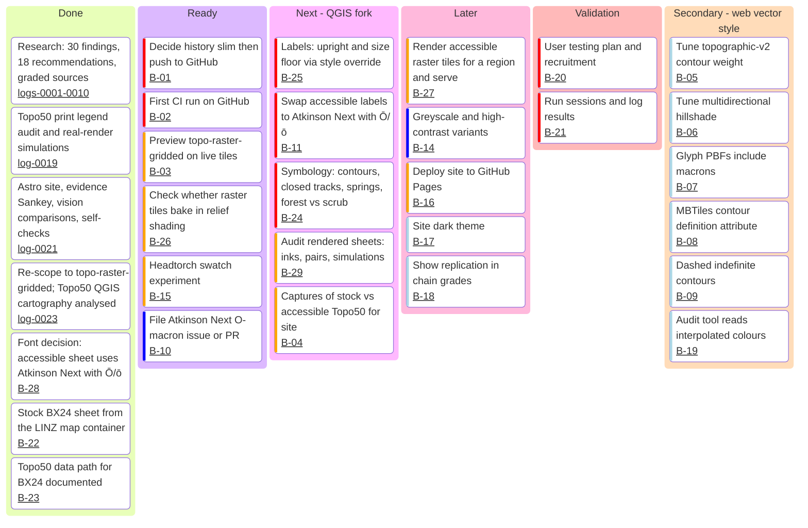

# Backlog

Status as of 2026-11-02, after log 0044 (R-03 optional hillshade overlay).
Log 0025 is the stock sheet. Log 0024 records the font decision: the
accessible sheet uses Atkinson Hyperlegible Next with Ō/ō; the stock sheet
keeps Nimbus. The estuary name draws upright (log 0029).
The square uses the sheet map layers. The pink lines were a hidden layer (log 0029).
Square draws use QGIS 4.2.3 at `/Applications/QGIS-final-4_2_3.app` (log 0031). The sheet export stays on the map image. QGIS 3.36.3 cannot open the project (log 0030).
R-09 is met. Suburb and Locality are 11 px. Town is 14 px. City is 17 px (log 0032).
R-07 is met. Label ink is at least 4.8:1 against the drawn buffer. The text-contrast table has no fail rows except the two highway shields (log 0033).
R-10 is met. Scrub is `#A3CC90` plus a hatch. Scattered is `#E0EDD8` plus a pattern (log 0034).
R-11 is met. Closed tracks have cross-bars. Historic labels keep hue and meet 3:1 under red light (log 0035).
R-17 is met. Hot is a black ×. Cold is a `#005C8F` circle. Native is `#E1EAC3`. Scrub keeps the hatch (log 0036).
R-01 is met. Intermediate contours have a 0.2 mm `#8A4F1C` casing. Index is 0.45 mm. Casing versus paper is 3.45:1 under red light (logs 0037, 0038).
R-08 stays provisional. Vector labels use 0.05 em from the style file. Raster along-line labels keep normal spacing. No A/B test (log 0039).
R-12 is met. `tracks.access.reserved_channel` is `casing_colour`. `tracks.access.painted` is false. Access is not drawn (log 0042).
R-03 stays open. Hillshade is an overlay at 337.5°. Raster shade waits for `dem.tif` beside the project. Vector reads the same numbers (log 0044).
The starting point remains LINZ's `topo-raster-gridded`, i.e.
Topo50 itself (log 0023, R-18). IDs are stable;
reference them from commits and research-log entries. The board needs mermaid
with `kanban` support (11.4+); validated with mermaid 12.2.0.

## Board

The coloured bar on each card is mermaid's priority marker (red = very high,
orange = high, dark blue = low, pale blue = very low). It's colour-only, so
priority is also written out in the table.

**Secondary track:** `styles/accessible-v0*.json` (derived from
`topographic-v2`) remains valid work and stays gated in CI, but it is not the
product. Its research and decisions carry over to the QGIS fork.

## Items

| ID | Priority | Item | Done when | Depends on | Refs |
|---|---|---|---|---|---|
| B-01 | Very High | Decide whether to drop superseded composite PNGs from history; create GitHub repo; push | Pushed; decision logged | — | OQ-14 |
| B-02 | Very High | First GitHub Actions run (`check`, `site`) | Both green on `main` | B-01 | R-14 |
| B-22 | Very High | Build LINZ's `map` container (`topographic-system/packages/map`) and render one sheet (e.g. BX24) with the **stock** `topographic-qgis` project | Stock PDF/PNG of one sheet committed as baseline | — | R-18 |
| B-23 | Very High | Obtain Topo50 GeoParquet data for that sheet (NZTopo50 QGIS plugin download or the project JSON referenced in `packages/map/README.md`) | Data path documented; render reproducible | — | R-18 |
| B-28 | High | Check AGPL-3.0 (+ font exemption) obligations if we modify or swap Nimbus Sans LINZ | Decision logged | — | R-18, R-06 |
| B-03 | High | Extend `preview/` to show `topo-raster-gridded` side by side; run on live tiles | Raster panes render | — | — |
| B-26 | High | Do served raster tiles include baked relief shading? Only then decide on the client hillshade direction for the raster style | Answer + decision logged | B-03 | R-03 |
| B-15 | High | Headtorch swatch experiment (print the six Topo50 inks + proposed inks) | Photos + measured contrast | — | OQ-08, F-21 |
| B-10 | Low | File Atkinson Next Ō/ō issue/PR (less urgent: QGIS shapes text, F-28) | URL logged | — | OQ-10 |
| B-25 | Very High | QML override: label FontStyle → upright; size floor (≥7 pt default, 6 pt min) | Re-rendered sheet; italic share 0% | B-22, B-23 | R-05, R-09, F-30 |
| B-24 | Very High | QML symbology: index/intermediate contours, closed-track symbol, distinct spring glyphs, forest vs scrub step, no red-orange-only meaning | Print audit pairs pass floors on re-render | B-22, B-23 | R-04, R-11, R-17 |
| B-29 | High | Audit rendered sheets (palette pairs, simulations) and add to site comparisons | Before/after on site | B-24, B-25 | R-14 |
| B-04 | High | Captures of stock vs accessible Topo50 at the 7 scenarios | On the site | B-27 or B-29 | R-16 |
| B-11 | Very High | Accessible QGIS labels use Atkinson Hyperlegible Next with Ō/ō added (OFL patch). Stock sheet stays Nimbus | Accessible sheet uses the patched face, beside the stock sheet | B-22, B-23 | R-06, F-26, F-28, F-29, log 0024 |
| B-27 | High | Render accessible raster tiles for a region; serve alongside `topo-raster-gridded` | Preview shows both | B-24, B-25 | R-18 |
| B-14 | Low | Greyscale-safe print and high-contrast variants from the QGIS fork | Variants rendered + gated | B-24 | R-13 |
| B-16 | High | Deploy site (GitHub Pages, `SITE_BASE`) | Public URL | B-02 | — |
| B-17 | Very Low | Site dark theme | S1–S3 pass in both schemes | — | — |
| B-18 | Very Low | Replication shown in chain grades | Trace page updated | — | — |
| B-20 | Very High | User testing plan + recruitment | Plan doc | B-24, B-25 | R-16 |
| B-21 | Very High | Run sessions; log results | Grade-B findings from our own study | B-20 | R-16 |
| B-05–B-09, B-19 | Very Low | Secondary web-vector track (see board) | — | — | logs 0013–0020 |
