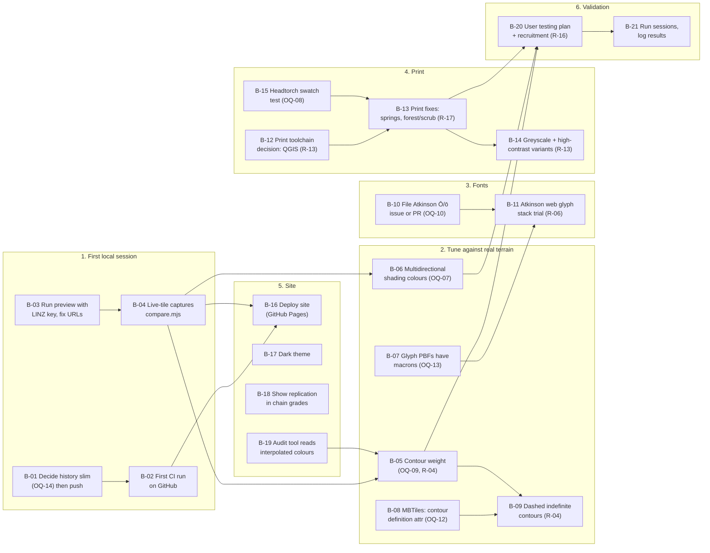

# Backlog

Ordered work for the next phase (local development). IDs are stable; link
them from commits and research-log entries like R-/F-/OQ- IDs.
Status as of 2026-11-01, commit after log 0022.

## Dependency map

## Items

| ID | Item | Why / evidence | Done when | Refs |
|---|---|---|---|---|
| B-01 | Decide whether to drop superseded composite PNGs from history, then create the GitHub repo and push | Repo is ~22 MB because of old `docs/visuals/02-*` / `07-*` versions | Pushed; decision noted in log | OQ-14 |
| B-02 | First GitHub Actions run of `check` and `site` jobs | Workflow has only been run locally from a clean clone | Both jobs green on `main` | R-14 |
| B-03 | Run `preview/` against live LINZ tiles; fix URL rewriting / sprite paths if needed | Written and validated, never run on real tiles | Both panes render, sprites (stipple, cross-bars) visible | — |
| B-04 | Run `tools/screenshots/compare.mjs` for all 7 scenarios; commit captures; log what they show | Replaces synthetic scenes with real terrain | `docs/visuals/real/*/none.png` committed; site shows them | R-16 |
| B-05 | Tune contour weight on steep terrain (Arthur's Pass, Fiordland) | v0 intermediates may still be heavy; index must carry relief under red light | Before/after captures + gate floors updated | OQ-09, R-04 |
| B-06 | Tune multidirectional hillshade colours/weights | Values are provisional; never seen on real terrain | Alpine and plains captures look right; R-03 log entry | OQ-07, R-03 |
| B-07 | Fetch LINZ glyph PBF range 256–511 for every font stack used; confirm Ā–Ū | Our macron check used google/fonts builds, not LINZ-served glyphs | Script + result in log; gate C5 updated if needed | OQ-13, F-12 |
| B-08 | Download `topographic-v2` MBTiles; inspect contour attributes | Need `definition = indefinite` for dashed contours | Attribute list recorded in `tile-attributes.md` | OQ-12 |
| B-09 | Dashed indefinite contours | Accuracy is lower in forest/snow; should be visible | Style transform + gate | R-04, F-18 |
| B-10 | Check tracker, file Atkinson Next Ō/ō issue (or PR with two composites) | Draft ready in `docs/upstream/` | Issue/PR URL in log | OQ-10, F-29 |
| B-11 | Trial Atkinson Next on web (patched or upstream-fixed) with self-built glyph PBFs | Better I/l/1 and O/0 separation for grid refs and trig IDs | Side-by-side capture + decision | R-06, F-28 |
| B-12 | Choose print toolchain (likely QGIS project generated from the same parameters) | Print output doesn't exist yet | Decision log + skeleton project | R-13 |
| B-13 | Implement print-specific fixes | Springs fail greyscale; forest vs scrub tint-only; italics in contour labels | Print audit pairs pass floors | R-17, P3–P9 |
| B-14 | Greyscale-safe print and high-contrast web variants | Photocopies, e-ink, low vision | Variants built + gated | R-13, F-23 |
| B-15 | Headtorch swatch experiment: print swatches, photograph under red/white modes | Red-light evidence is anecdotal + model | Photos + measured contrast in log | OQ-08, F-21 |
| B-16 | Deploy site (GitHub Pages; set `SITE_BASE`) | Site builds; not hosted | Public URL; Pages job in CI | — |
| B-17 | Dark theme for the site | Quality floor; maps stay on white | Passes S1–S3 in both schemes | — |
| B-18 | Show replication in chain grades (e.g. "B ×2 replicated") | "Best single source" understates F-14 | Grades on trace page reflect replication | — |
| B-19 | `palette_audit.py` evaluates interpolated/zoom colours | Index contours were missed in the first audit | Audit reports per-zoom values | log 0013 |
| B-20 | User testing plan + recruitment (tramping club, LandSAR, CVD, dyslexic and 60+ readers) | All perceptual claims are grade D until tested | Plan doc + ethics/consent approach | R-16 |
| B-21 | Run sessions; log results; revise recommendations | Closes the evidence loop | Findings with grade B from our own study | R-16 |

## Not in scope (yet)
- Track access status on the map (R-12): needs Walking Access Commission data.
- 1:25k products.
